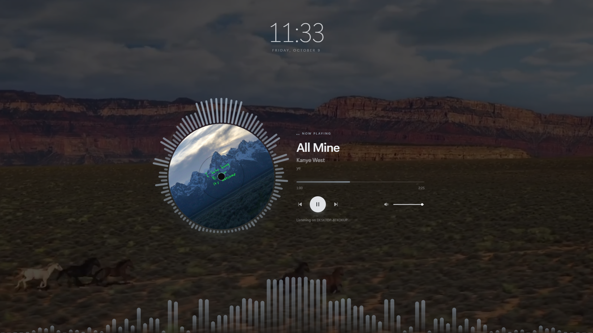
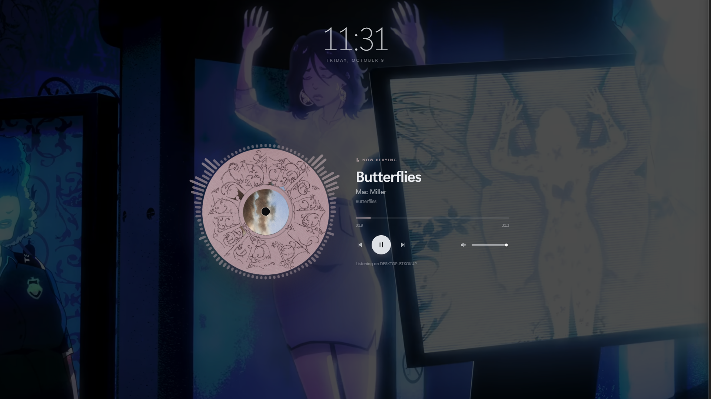
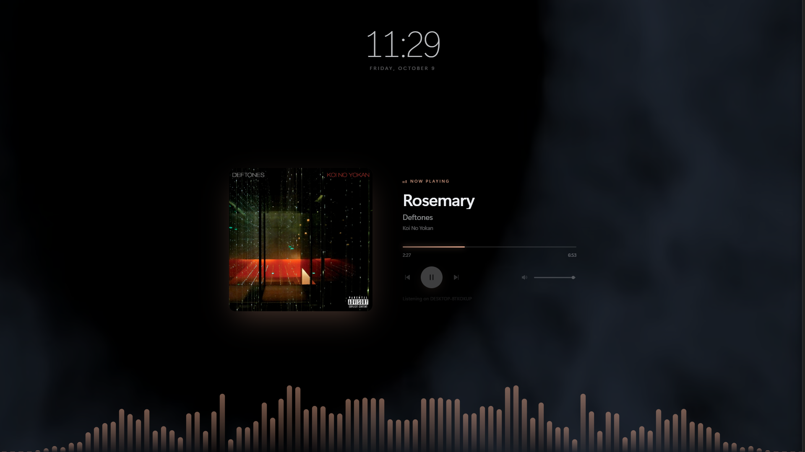
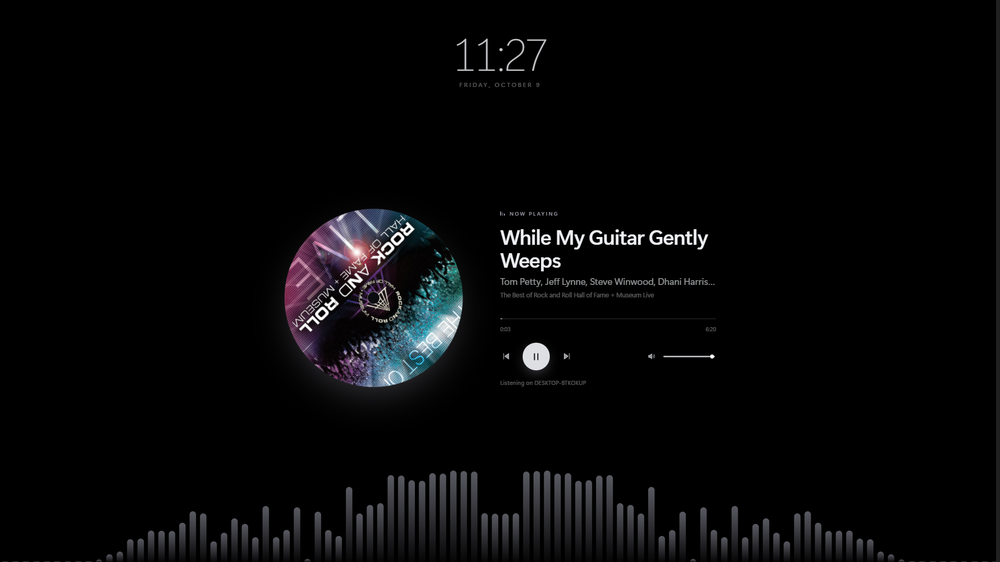
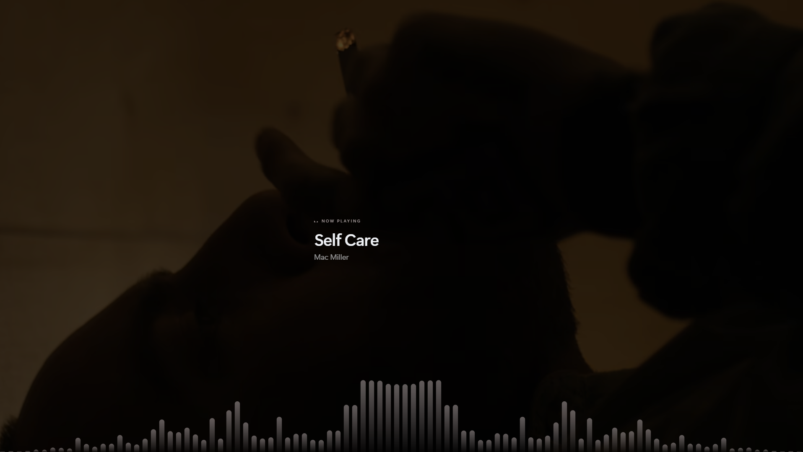
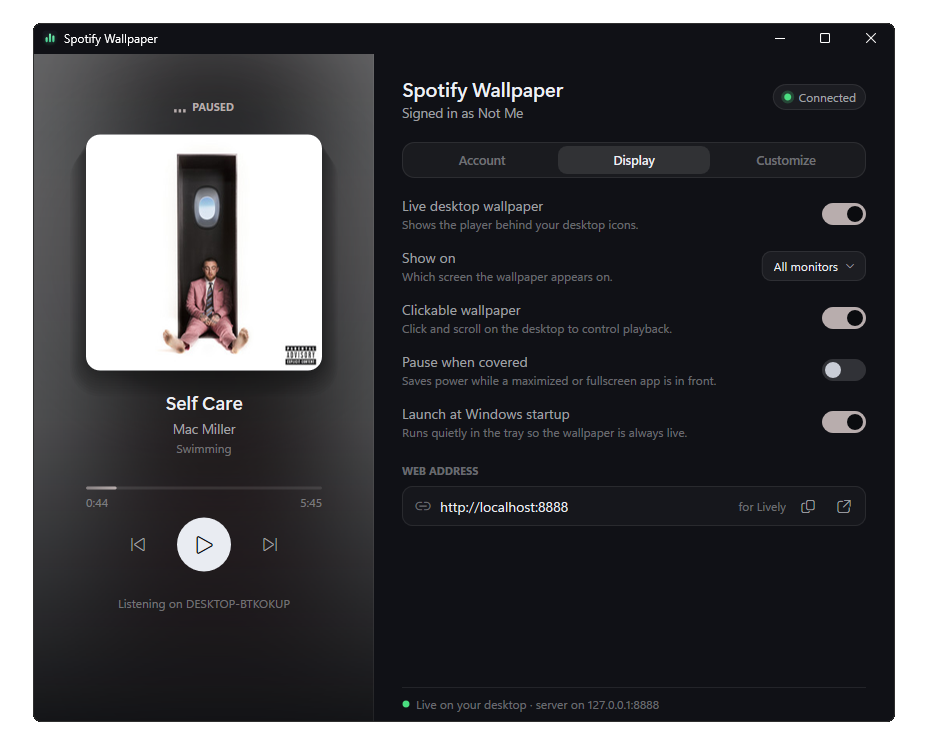

# Spotify Wallpaper

An app that allows you to control and view Spotify music straight from your wallpaper

With it being based off of C++ and Microsoft Edge WebView2 it is extremely optimized and uses very few resources
## Downloads

- [Portable build](https://github.com/NotMe3555/SpotifyWallpaper/releases/latest/download/SpotifyWallpaper-portable.zip)
- [Windows installer](https://github.com/NotMe3555/SpotifyWallpaper/releases/latest/download/SpotifyWallpaper-setup.exe)
- [All releases](https://github.com/NotMe3555/SpotifyWallpaper/releases)

## Screenshots

  
  
  

  
  
  

## Requirements

- Windows 10 or 11, 64-bit
- Microsoft Edge WebView2 Runtime for the live wallpaper (included with Windows 11; install it from [Microsoft](https://developer.microsoft.com/microsoft-edge/webview2/) on Windows 10 if needed)
- The Spotify desktop app, running on the same PC
- Optional: YouTube Data API key as a backup for music video search

